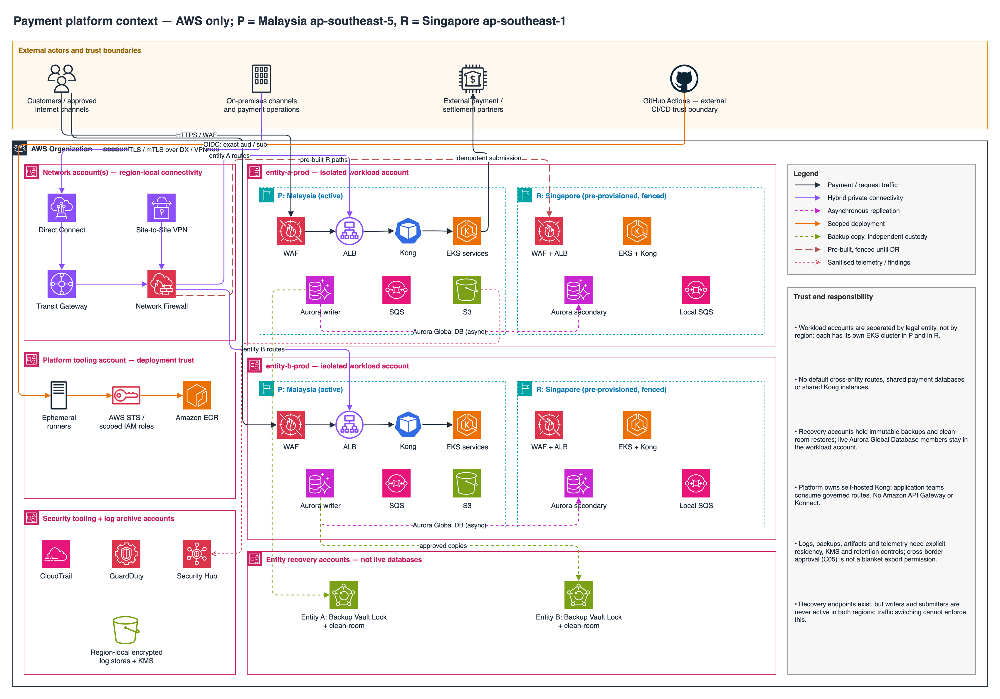

# Payment platform context

**Status: design draft; not implemented or operationally validated.** AWS is the only runtime cloud. P = Malaysia (`ap-southeast-5`); R = Singapore (`ap-southeast-1`). Cross-border approval is **granted per bank confirmation (assumption C05)**; its evidence reference is pending and this is not regulator-verified.

Editable source: [context-diagram.drawio](context-diagram.drawio) (open in draw.io / diagrams.net).

## Trust and responsibility

- Workload accounts are separate by entity, **not** by region: each has its own EKS cluster in P and another in R. There are no default cross-entity routes, shared payment databases, or shared Kong instances.
- Recovery accounts hold immutable backups and isolated clean-room restores. Live Aurora Global Database members remain in the corresponding workload account, not the recovery accounts.
- Security tooling, log archive, network and platform tooling accounts are separate from workload accounts and one another. Shared administration does not imply unrestricted data access. Logs, backup copies, artifacts, secrets and telemetry require explicit destination, retention, KMS and residency controls; cross-border approval is not blanket permission to export all data.
- Platform owns self-hosted Kong; product/application teams consume its approved routing capability. "Gateway consumers" does not automatically create Kong Consumer entities. No Amazon API Gateway, Konnect or external Kong control plane is proposed.
- Recovery endpoints are provisioned, but payment writers and external submitters must not become active in both regions. Traffic switching alone cannot enforce this.

## Related design and evidence

[Logical architecture](logical-architecture.md) | [Deployment topology](deployment-architecture.md) | [Hybrid connectivity](hybrid-connectivity.md) | [Recovery](dr-architecture.md) | [Ownership and RACI](../governance/ownership-model.md).

[Provider-native evidence register](../appendix/provider-native-evidence.md): **S1** Control Tower/account governance; **S2** EKS networking; **S5** Aurora global recovery; **S11** Backup Vault Lock; **S13-S14** Direct Connect and Transit Gateway. Source IDs identify required supporting evidence, not proof that this design has been deployed.
