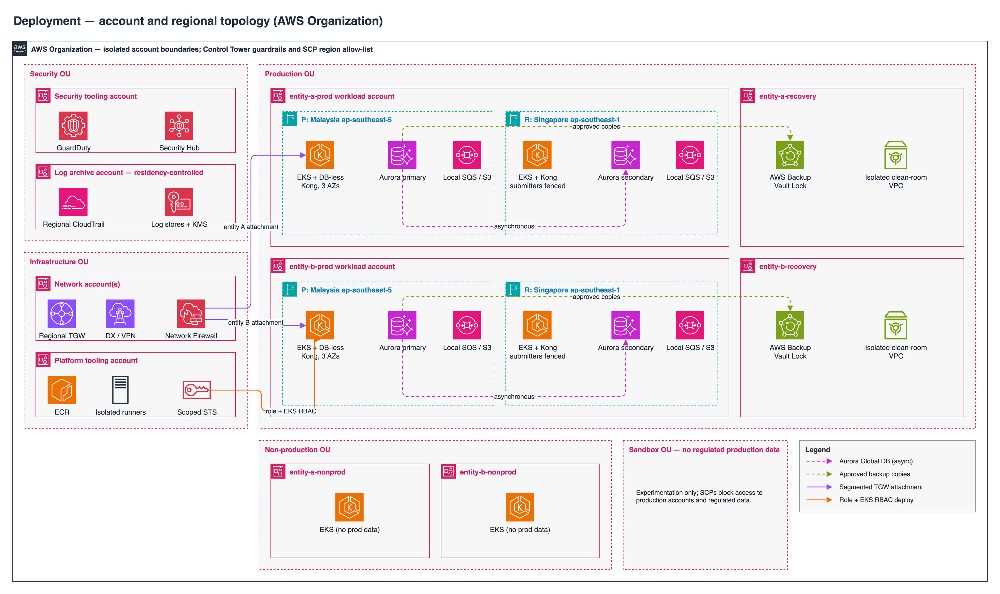
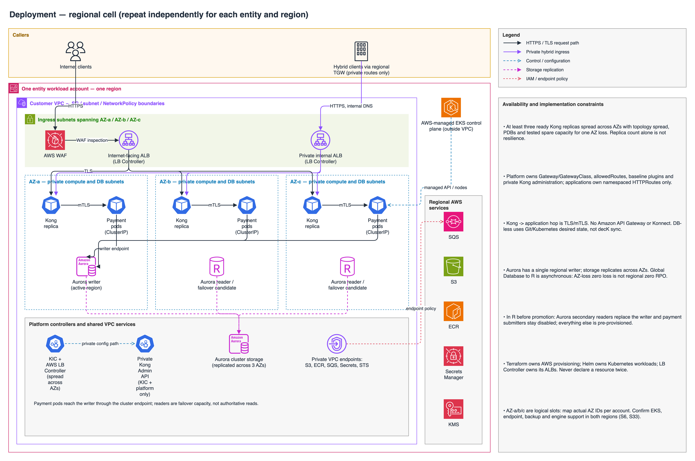

# Deployment architecture

P = Malaysia `ap-southeast-5`; R = Singapore `ap-southeast-1`. AZ-a/b/c below are logical slots: map actual AZ IDs and supported capacity per account, rather than assuming identical AZ names across accounts.

## Account and regional topology

Editable source: [deployment-accounts.drawio](deployment-accounts.drawio) (open in draw.io / diagrams.net).

No default cross-entity connectivity exists. Security tooling, log archive, network and platform tooling are distinct accounts, not a combined shared workload account. Live global database members are in the entity workload account in both regions. Recovery accounts are for backup/clean-room isolation, **not** live Aurora secondaries.

## Regional cell: repeat independently for each entity and region

The detailed cell below depicts an active region. In R before promotion, substitute Aurora secondary readers for the writer and keep payment submitters disabled; all ingress, EKS, Kong and supporting resources are preprovisioned.

Editable source: [deployment-regional-cell.drawio](deployment-regional-cell.drawio) (open in draw.io / diagrams.net).

## Availability and implementation constraints

- Kong is a **proposed per-entity, per-region DB-less deployment with KIC**, at least three ready replicas spread across AZs. Enforce topology spread/anti-affinity, disruption budgets and tested spare capacity for an AZ loss; replica count alone does not prove resilience. Payment pods and controllers also require appropriate spreading and recovery capacity.
- Platform owns Gateway/GatewayClass, `allowedRoutes`, baseline plugins/authentication and private Kong administration. Applications own approved namespaced HTTPRoutes. Dedicated fronting resources belong to the AWS Load Balancer Controller; application route reconciliation belongs to KIC. No arbitrary public NodePort/LoadBalancer services, global plugin overrides or application admin access.
- The Kong -> application hop is TLS/mTLS, even where combined in the diagram. SGs, NetworkPolicy and admission prevent bypass. No Amazon API Gateway or Konnect is involved. DB-less has no configuration DB and uses Git/Kubernetes desired state, not decK sync.
- Aurora has regional storage replicated across AZs, a single active regional writer and failover readers. Aurora Global Database adds **asynchronous** cross-region replication; expected AZ-failure zero loss is not a guaranteed regional zero RPO. There is one active global write region; a promoted secondary becomes its new regional writer.
- The existing AWS matrix lists Aurora PostgreSQL Global Database support in both P and R. Final engine version, features, instance classes, quotas and capacity must be checked before approval. Validate all required EKS, controller, endpoint, backup and network features in each region as well.
- Terraform owns AWS provisioning; Helm owns Kubernetes workloads, with explicit controller-owned AWS-resource exceptions such as ALBs. Never declare the same resource in two states or under competing reconcilers.
- Preposition R images/chart digests, routes, keys, certificates, secrets, DNS, network and database capacity. Do not rely on cross-region KMS keys or secret values becoming available automatically.
- Residency controls apply separately to logs, findings, state, artifacts and backup copies.

[Logical flow and control ownership](logical-architecture.md) | [DR architecture](dr-architecture.md) | [Hybrid networking](hybrid-connectivity.md) | [Delivery governance](../governance/deployment-governance.md).

[Provider-native evidence](../appendix/provider-native-evidence.md): **S1** Control Tower; **S2-S3** EKS networking/Pod Identity; **S4** Aurora HA; **S5** global recovery; **S6** region support; **S9-S10** Kong DB-less/KIC; **S11** Backup Vault Lock.
