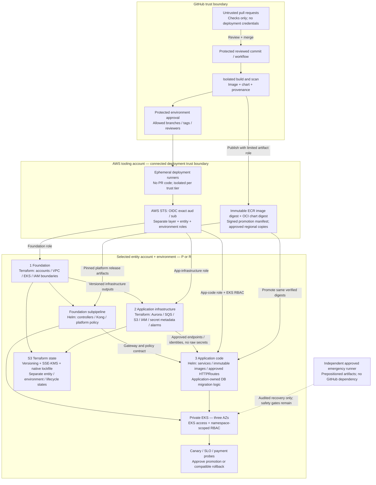

# Deployment pipelines

**Status: design draft; not implemented.** Terraform provisions AWS infrastructure; GitHub Actions orchestrates delivery; Helm releases EKS workloads. There are **three delivery layers**. The platform Kubernetes/Kong release is a **subpipeline of foundation**, not a fourth layer.

## Ownership and artifact contracts

| Layer | Resource owner and tools | Promotion artifact / acceptance |
| --- | --- | --- |
| Foundation | Platform accountable for the foundation release; network/security/account owners approve their resources. Terraform owns accounts, VPC, routing, EKS nodes/access and AWS controller identities. Foundation's Helm subpipeline owns platform controllers, Kong lifecycle, Gateway/GatewayClass, route delegation and baseline policies. | Reviewed Terraform commit, provider/module locks and approved saved plan; pinned controller/Kong charts and images, policy bundle, upgrade/compatibility report and platform readiness checks. |
| Application infrastructure | Application infrastructure owner provisions Aurora, SQS, S3, service IAM/Pod Identity associations, secret metadata and alarms with Terraform; data/security owners approve sensitive changes. | Approved saved plan, state identity, drift check, versioned outputs and database/queue/identity contracts. No raw secrets in published outputs. |
| Application code | Application team owns image, Helm release, services, approved namespaced HTTPRoutes and DB migration logic; platform enforces RBAC/admission. | Build-once image **digest** and OCI chart **digest**, signatures/provenance, scan results, configuration identity, migration checksum/compatibility and canary/SLO evidence. |

AWS resources created by controllers have one explicit owner: the AWS Load Balancer Controller owns Kong-fronting ALBs from platform Kubernetes resources; Terraform must not also declare those ALBs. KIC owns application route reconciliation, not the ALB. Helm and Terraform must not independently own the same Kubernetes workload. State separation follows resource lifecycle, not arbitrary duplicate declarations.

## Identity and runner rules

- Configure STS trust for the actual issuer `https://token.actions.githubusercontent.com`, exact `aud = sts.amazonaws.com` for the standard AWS audience, and exact intended `sub`. Do not use organization-wide or repository-wide subject wildcards for production deployment.
- Default environment-bound subject: `repo:ORG/REPO:environment:ENV`. Without an environment, a branch subject is `repo:ORG/REPO:ref:refs/heads/BRANCH`. These are **templates**, not deployable literal values. Inspect actual organization subject customization and GitHub escaping (for example `:` in metadata becomes `%3A`) before writing trust policies.
- An environment subject does **not** contain the branch. Enforce environment deployment branches/tags, required reviewers, protected branches and workflow-change controls separately. Verify each actual role assumption with negative tests for PRs, wrong refs, environments and entities.
- Split roles by layer + entity + environment, restrict regional actions where applicable, and avoid one universal deployment role. Foundation subpipeline privilege is a scoped foundation role, not a new delivery layer. Limit session duration, `iam:PassRole`, resource scope and EKS access/RBAC.
- Untrusted PR code never runs on connected deployment runners or inherits deployment credentials. Use isolated, ephemeral runners with private endpoint connectivity; verify runner cleanup and use immutable reviewed actions/dependencies. Build publication privileges do not grant production deployment rights.

## Promotion and rollback

1. Run existing checks, IaC policy/security review, application tests, image/chart scans and provenance verification on the reviewed commit. Build once; resolve immutable digests, never deploy a mutable tag as the release identity.
2. Validate an approved saved Terraform plan against the intended account, region, role and state. Apply that plan only if still valid; state/drift changes require re-plan and reapproval, not silent regeneration. Separate foundation and application-infrastructure changes from application release privileges.
3. Promote the same image/chart digests through environments and per-entity approvals. Use region-specific configuration and secrets outside the artifacts; copy and verify approved digests into recovery-accessible repositories before declaring readiness.
4. Execute compatible expand/contract migrations with application-owned logic and data-owner approval. Deploy canaries, test payment authorization/idempotency, and evaluate defined error, latency, saturation and payment-reconciliation SLO gates before rollout.
5. Roll back to previously approved digests only if DB compatibility is proven. Do not assume Terraform reverse-apply or a destructive schema downgrade is safe. Pause/roll forward under approval where rollback would lose data.

Terraform state uses versioned, encrypted S3, restricted IAM/KMS and supported S3 native locking (`use_lockfile = true`, with a pinned compatible Terraform version). Split by entity, environment and lifecycle (foundation versus app infrastructure, with explicit regional/shared ownership). Protect backend bootstrap separately. Serialize changes, audit lock recovery and prohibit casual production destroy. Keep secret values out of Terraform where possible; state and plan files remain sensitive even when outputs are marked sensitive.

GitHub-independent emergency recovery uses predeployed resources and independently available approved artifacts/runner credentials. Normal promotion approvals do not replace the [DR fencing and reconciliation gates](dr-architecture.md).

[Deployment governance](../governance/deployment-governance.md) · [Consolidated RACI](../governance/ownership-model.md) · [Kong contracts](logical-architecture.md).

[Provider-native evidence](../appendix/provider-native-evidence.md): **S3** Pod Identity; **S7** GitHub OIDC; **S8** Terraform S3 backend; **S9–S10** Kong DB-less/KIC. No decK sync is part of this proposed DB-less release model.
