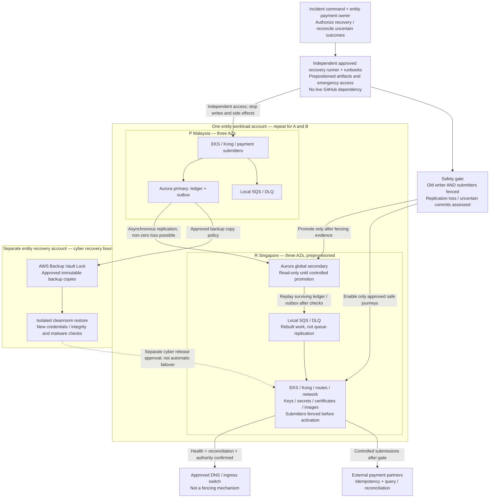

# Disaster recovery architecture

**Status: design draft; not implemented or exercised.** Each entity recovers independently from Malaysia P (`ap-southeast-5`) to Singapore R (`ap-southeast-1`). Cross-border approval is user-confirmed granted; evidence reference is pending and is not regulator-verified.

## Recovery objectives and safety

| Scenario | Draft objective | Preconditions and limitations |
| --- | --- | --- |
| Single AZ failure | Expected zero loss of committed Aurora transactions; critical journeys restored within the draft ≤30-minute disruption-to-safe-service target | Regional Aurora failover, pod rescheduling, surviving ingress/network capacity and connection retry must be exercised. In-flight partner outcomes still need reconciliation. |
| Regional disaster | RTO **≤30 minutes from disruption to safe critical journeys**, not from declaration or promotion | Unmeasured target. Includes detection, decision, fencing, promotion, replay, reconciliation and validation. If safety cannot be established, keep affected journeys stopped even if the target is missed. |
| Regional data loss | Near-zero RPO aspiration, **not guaranteed zero** | Global replication is asynchronous. Lag metrics inform exposure but cannot prove the status of every uncertain commit. No acknowledged regional zero-loss claim is made. |
| Cyber compromise | Separate cleanroom restore RTO/RPO, to be agreed and measured | Immutable backup age, integrity validation, credential rotation, rebuild and business reconciliation dominate; the 30-minute regional target does not apply. |

## Ordered regional recovery

1. **Detect and declare:** operations records disruption time, scope, affected entities, replication health and the last trustworthy business checkpoint. The entity payment owner and incident commander authorize the runbook.
2. **Fence before promotion:** stop/revoke the old region's write and external-submission authority. Use an independently enforceable write/submitter lease or equivalent controlled authority, network/credential restrictions and termination controls. The exact mechanism and partition behavior are an implementation gate: IAM revocation alone may not end existing sessions. If fencing cannot be demonstrated, do not enable unsafe writes. DNS changes are not fencing.
3. **Assess loss and uncertain outcomes:** identify replicated ledger/outbox progress, missing or ambiguous acknowledgements and partner-side submissions. Query partner status using stable idempotency keys; quarantine unknowns until resolved. Do not infer that absence from the surviving database means the payment never happened.
4. **Promote:** data owner executes the approved Aurora global recovery procedure, verifies the new writer and updates regional endpoints/secrets as required. R networking, EKS/Kong, Gateway/HTTPRoutes, IAM, KMS, certificates and immutable images/charts must already be usable.
5. **Rebuild work:** replay only surviving committed ledger/outbox records into R-local SQS with deduplication and controlled redrive. Reconcile external outcomes before resubmission. There is no automatic SQS replication or recovery of lost outbox entries.
6. **Validate then switch:** run private critical-journey probes, authorization/idempotency checks, database validation and canary/SLO checks. Enable new submitter authority only after old authority is fenced; switch approved ingress/DNS and release safe journeys under business approval.
7. **Stabilize and fail back separately:** keep P fenced, reconcile financial totals and retain evidence. Rebuild P as a secondary and conduct a separately approved planned switchover; do not simply reverse DNS or rejoin divergent data.

## Recovery readiness and cyber isolation

- R is not a just-in-time infrastructure build. Establish routes to both countries, network inspection, local ECR image/chart copies, regional secrets/key access, DB capacity and operational access before an incident.
- GitHub unavailability must not block predeployed recovery. Maintain approved independently accessible signed/digest-verified artifacts, runbooks and a controlled connected runner with time-bound emergency credentials and audit export. This is a recovery path, not unrestricted CI/CD bypass or permission to run untrusted code.
- Recovery accounts contain per-entity immutable backups and isolated cleanroom restores, never the live Aurora global topology. Validate supported backup/copy features, Vault Lock mode/retention, independent KMS custody and restore permissions. Approval for cross-border processing does not implicitly authorize every backup/log export.
- Exercises must cover AZ loss, regional partition, inaccessible old primary, lagging replication, partner timeouts, duplicate delivery, GitHub outage, and cyber restore. Record actual elapsed time, data exposure, fencing evidence and financial reconciliation; no measured RTO is claimed.

[Deployment topology](deployment-architecture.md) · [Hybrid paths](hybrid-connectivity.md) · [Recovery ownership](../governance/ownership-model.md) · [Emergency governance](../governance/deployment-governance.md).

[Provider-native evidence](../appendix/provider-native-evidence.md): **S4** Aurora HA; **S5** global recovery; **S6** region/feature support; **S11** Backup Vault Lock; **S12** SQS. Engine/feature/capacity checks and the exact fencing implementation remain approval gates.
