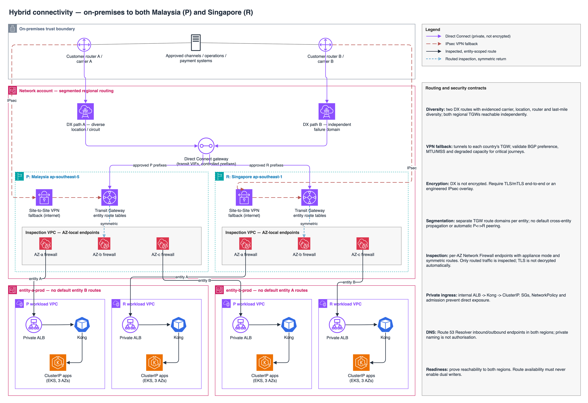

# Hybrid connectivity

On-premises connectivity must reach both Malaysia P (`ap-southeast-5`) and Singapore R (`ap-southeast-1`).

Editable source: [hybrid-connectivity.drawio](hybrid-connectivity.drawio) (open in draw.io / diagrams.net).

The diagram aggregates paths for readability: actual TGW attachment, inspection VPC and subnet route tables must explicitly select the correct AZ endpoint and a symmetric return path. It does not imply packets traverse all three firewall endpoints or that one shared route table connects the entities.

## Routing and security contracts

| Area | Required design |
| --- | --- |
| Diverse connectivity | Two DX routes with evidenced carrier, location, customer-router and last-mile diversity; redundant virtual interfaces/BGP sessions as engineered. Both regional TGWs are reachable independently through approved Direct Connect gateway associations. Two circuits sharing a failure domain do not establish diversity. |
| VPN fallback | Site-to-Site VPN tunnels to each country's TGW over an independent internet underlay; engineer both customer-router paths. Validate BGP preference, convergence, MTU/MSS and degraded-mode capacity so VPN can sustain agreed critical journeys. |
| Encryption | Direct Connect is **not inherently encrypted**. Require TLS/mTLS end-to-end or an explicitly engineered IPsec overlay where network-layer encryption is required; ordinary public-internet VPN fallback does not encrypt the primary DX path. |
| Entity segmentation | Separate TGW routing domains and controlled attachment associations/propagations. No default cross-entity route propagation, broad shared-service reachability or automatic P<->R TGW peering. Any exception needs entity and security approval with narrow prefixes/ports and return routes. |
| Stateful inspection | Force intended hybrid/egress flows through AWS Network Firewall endpoints per AZ. Engineer TGW appliance mode where required and route-table symmetry, including failure paths; avoid asymmetric flows that bypass inspection or break state tracking. |
| Inspection limits | Network Firewall observes **only paths routed through it**. It does not automatically inspect ALB ingress, Aurora global replication, VPC endpoint traffic or pod east-west traffic. It does not automatically decrypt TLS; any TLS inspection requires explicit supported configuration, certificate trust and compliance review. |
| Private ingress | Hybrid consumers use private DNS and internal ALB -> Kong -> ClusterIP services. AWS Load Balancer Controller owns fronting ALBs; KIC owns application HTTPRoutes. SGs, NetworkPolicy and admission prohibit direct app exposure and Kong-admin reachability. |
| Identity and names | TLS/mTLS and application authentication/authorization remain required on private links. Engineer Route 53 Resolver inbound/outbound endpoints and conditional forwarding in both regions with restricted DNS paths; private naming alone is not authorization. |
| AWS service access | Use supported regional VPC endpoints with endpoint policies and scoped IAM where appropriate. Public service/partner egress follows approved inspected routes; document exceptions. Do not assume private endpoints traverse Network Firewall. |
| Residency and telemetry | Regional flow/firewall/DNS logs go to approved encrypted log destinations with redaction and retention controls. Explicitly authorize cross-border routes and log/backup copies; central account administration need not centralize raw data outside Malaysia. |

## Resilience acceptance

- Prove on-premises reachability to **both** regions before recovery readiness; do not rely on a Malaysia-only relay to reach Singapore.
- Exercise each DX circuit loss, customer-router loss, VPN takeover, firewall endpoint/AZ failure, DNS dependency failure and regional isolation. Confirm symmetry, inspection, throughput and no accidental entity-to-entity reachability.
- Route availability must not enable dual payment writers or submitters. Singapore can be reachable while processing remains fenced. [Recovery safety gates](dr-architecture.md) precede traffic activation; DNS/BGP changes alone do not fence writers.
- Foundation owns the network resources and changes, with network-team route/capacity responsibility and security approval. Application teams provide partner allowlists and service requirements, not unrestricted route-table edits.

[Context](context-diagram.md) | [Deployment architecture](deployment-architecture.md) | [Ownership and RACI](../governance/ownership-model.md) | [Foundation governance](../governance/deployment-governance.md).

[Provider-native evidence](../appendix/provider-native-evidence.md): **S13** Direct Connect; **S14** Transit Gateway; **S2** EKS networking. Firewall routing, VPN capacity, encryption and dual-country readiness still require implementation evidence.
