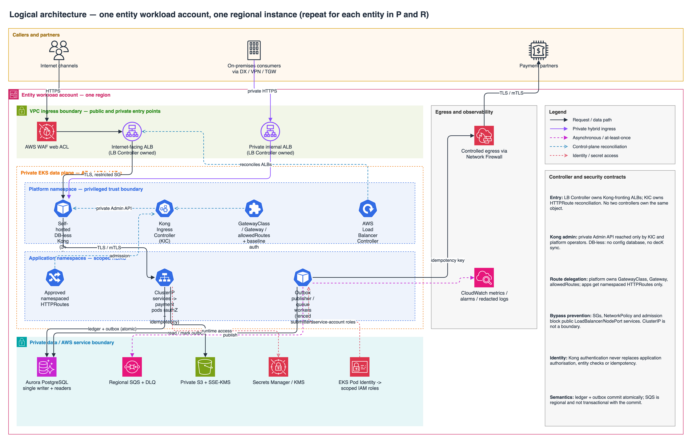

# Logical architecture

**Status: design draft; not implemented.** This pattern is instantiated independently for entity A and entity B, in Malaysia P and Singapore R. R is preprovisioned but payment processing remains fenced until approved recovery activation.

Editable source: [logical-architecture.drawio](logical-architecture.drawio) (open in draw.io / diagrams.net).

## Controller and security contracts

| Boundary | Contract |
| --- | --- |
| Entry | AWS Load Balancer Controller reconciles the ALBs fronting Kong through dedicated platform-owned resources. KIC reconciles application HTTPRoutes to Kong. The controllers must not both own the same routing resource; classes, RBAC and admission enforce separation. |
| Kong administration | Platform alone has privileged access. KIC reaches a private Admin API; no public admin endpoint or application-team admin credentials. Kubernetes desired state and reviewed Git manifests are the versioned configuration source. DB-less means **no Kong configuration database and no decK sync**. |
| Route delegation | Platform owns GatewayClass, Gateway, `allowedRoutes`, approved cross-namespace references and baseline authentication/plugin controls. Apps receive namespace-scoped HTTPRoute permissions only; admission prevents host/path hijacking and unauthorized policy overrides. |
| Bypass prevention | Only approved ingress can reach Kong; only Kong and approved internal callers can reach payment services. Restricted security groups, Kubernetes NetworkPolicy and admission prohibit arbitrary public LoadBalancer/NodePort services and direct application ingress. ClusterIP alone is not a security boundary. |
| Identity | Evaluate Pod Identity support and least-privilege associations per service account. Kong authentication does not replace application authorization, tenant/entity checks or payment idempotency. TLS/mTLS protects hops to services; certificate rotation is platform-integrated. |
| Kong acceptance | DB-less/KIC versions, Gateway API support, plugin compatibility, licensing, authentication dependencies and rate-limit semantics require assessment. Local per-replica counters are **not** a global limit; any distributed counter dependency requires explicit design, availability and residency approval. No external Kong control plane. |

## Payment and data semantics

- Commit ledger changes and an outbox record atomically in Aurora. SQS is region-local and not transactionally coupled to that commit; publishers retry and consumers deduplicate. DLQ redrive is controlled and observable.
- Across regions, Aurora Global Database replicates P -> R asynchronously. Recovery reconstitutes work from the **surviving** ledger/outbox; neither SQS queues nor unreplicated commits magically recover. Partner submissions use stable idempotency keys and query/reconcile uncertain outcomes before replay.
- Each region has one writer when primary and readers distributed for failover; R is a read-only global secondary before promotion. AWS-managed EKS control planes are outside the customer VPC; see the [physical deployment](deployment-architecture.md).
- EKS/Helm is the selected workload approach. ECS and Lambda are not additional delivery targets in this baseline.

[Pipeline ownership](deployment-pipelines.md) | [Recovery controls](dr-architecture.md) | [Consolidated RACI](../governance/ownership-model.md).

[Provider-native evidence](../appendix/provider-native-evidence.md): **S2** EKS networking; **S3** Pod Identity; **S4-S6** Aurora HA, global recovery and region support; **S9-S10** Kong DB-less and KIC; **S12** SQS. **S15** ECS and **S16** Lambda are comparison sources, not selected components.
